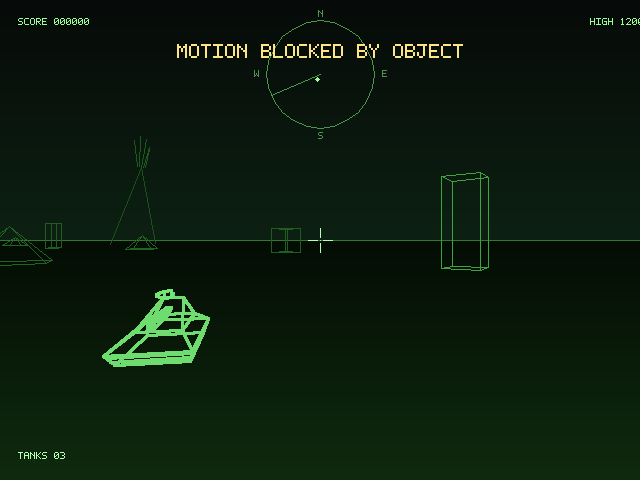
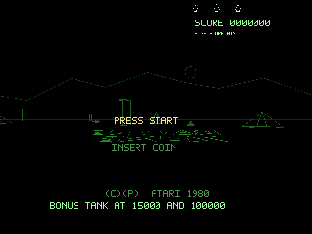

# Battlezone

[](https://sonarcloud.io/summary/new_code?id=stephenlclarke_battlezone)
[](https://sonarcloud.io/summary/new_code?id=stephenlclarke_battlezone)
[](https://sonarcloud.io/summary/new_code?id=stephenlclarke_battlezone)
[](https://sonarcloud.io/summary/new_code?id=stephenlclarke_battlezone)
[](https://sonarcloud.io/summary/new_code?id=stephenlclarke_battlezone)
[](https://sonarcloud.io/summary/new_code?id=stephenlclarke_battlezone)
[](https://sonarcloud.io/summary/new_code?id=stephenlclarke_battlezone)
[](https://sonarcloud.io/summary/new_code?id=stephenlclarke_battlezone)
[](https://sonarcloud.io/summary/new_code?id=stephenlclarke_battlezone)
[](https://sonarcloud.io/summary/new_code?id=stephenlclarke_battlezone)
[](https://sonarcloud.io/summary/new_code?id=stephenlclarke_battlezone)


---

This is a self-contained Rust implementation of Atari's original Battlezone, rendered in a native window through wgpu.

The current game uses a native Rust state machine for twin-stick tread movement, title and high-score screens, battlefield layout, radar, enemy behaviors, saucer timings, and scoring/lives flow. During development the obstacle layout, attract-screen data, and rule tables were extracted from the original arcade ROM set, but the shipped application no longer depends on any ROM files at runtime.



<!-- markdownlint-disable MD033 -->
<p align="center">
  
</p>
<!-- markdownlint-enable MD033 -->

Run targets:

- `cargo run`
- `make run`
- `cargo test`
- `cargo fmt --check`
- `cargo clippy --all-targets -- -D warnings`
- `make ci`
- `make coverage`
- `make sq-ci`
- `make sq`
- `make readme-media`

Run `cargo run` or `make run` to open the Battlezone window. A graphical desktop and a wgpu-compatible GPU are required.

## Install

Install with Homebrew:

```sh
brew tap stephenlclarke/tap
brew trust --tap stephenlclarke/tap
brew install stephenlclarke/tap/battlezone
battlezone --help
battlezone
```

To replace an older Kitty build, run `brew update` followed by `brew upgrade stephenlclarke/tap/battlezone`. Homebrew builds the pinned wgpu source with Rust; Linux builds also require ALSA and pkgconf, which the formula declares. Interactive play requires a graphical desktop and suitable GPU. The `--help` and `--version` commands work without a display.

Alternatively, install directly from git with Cargo:

```sh
cargo install --locked --git https://github.com/stephenlclarke/battlezone --branch develop battlezone
```

The Homebrew stable formula installs the checksum-verified wgpu source at commit `457237526a80061a9469f227b98cad090616c44d` as `1.0.0_1`. Both Cargo above and `brew install --HEAD stephenlclarke/tap/battlezone` follow `develop` rather than a release tag. The application reports upstream version `1.0.0`; use `brew list --versions battlezone` to see the Homebrew revision.

`cargo install` builds with Cargo's release profile by default. Do not pass `--debug` unless you explicitly want a slower debug build.

After installation, run the game with:

- `battlezone`

### Build from a checkout

```sh
git clone --branch develop https://github.com/stephenlclarke/battlezone.git
cd battlezone
cargo run --release
```

Rust and Cargo are required. On Debian/Ubuntu, install `libasound2-dev` before building; Homebrew supplies `alsa-lib` and `pkgconf` for Linux formula builds. The graphical desktop must provide a wgpu-supported GPU backend.

### Release binaries

The tag-triggered release workflow builds Linux x86_64/arm64, Windows x86_64, and macOS arm64 binaries and publishes a `battlezone-<tag>-SHA256SUMS.txt` manifest. The `v1.0.0` release predates this wgpu port and uses Kitty graphics. For the native window version, use the pinned Homebrew formula or the `develop` source commands above until a new wgpu release is tagged.

### Command-line options

- `battlezone`: open the game window.
- `battlezone --help` or `battlezone -h`: print usage and controls without initializing the display, GPU, or audio.
- `battlezone --version` or `battlezone -V`: print the upstream package version without opening a window.

Unknown options and multiple options are rejected.

## Controls

Arcade play controls:

- `1` or `Enter`: start from the title screen
- `Q` / `A`: left tread forward / reverse
- `P` / `L`: right tread forward / reverse
- `Up`: both treads forward
- `Down`: both treads reverse
- `Left`: pivot left
- `Right`: pivot right
- `Space`: fire
- `Esc`: quit

Holding `Q` + `P` together drives both treads forward like `Up`, and holding `A` + `L` together drives both treads backward like `Down`. Key releases stop the corresponding control; losing window focus clears held controls. Close the window or press `Esc` to quit.

### High-score initials

Use `P` or `Left` for the previous letter, and `L` or `Right` for the next letter. Press `Space`, `Enter`, or `1` to confirm a letter. Confirm all three letters to save the entry.

## XYZZY Mode

After starting a game, type `X`, `Y`, `Z`, `Z`, `Y` to toggle hidden `XYZZY` mode on or off.

Typing `XYZZY` a second time turns the mode off and resets every secret option back to its default state. If you activate `xyzzy` again later, it starts clean with all hidden options disabled and the fire-rate boost reset to its base level.

Letter-key controls accept either upper- or lower-case input.

Extra keys while `xyzzy` mode is active:

- `F`: increase the hidden fire-rate level with each press, up to a capped
  maximum.
- `G`: toggle god mode. While active, enemy units are drawn in red, enemy
  projectiles are orange, your projectiles are yellow, and enemy fire cannot
  kill the player tank.
- `H`: toggle hidden autopilot. While active, the tank will steer toward the
  current enemy, try to maintain a firing solution, and bias away from
  incoming shots and exposed positions.

## Notes

- This project is a native implementation, not a 6502 emulator.
- The battlefield obstacle coordinates, bonus-tank defaults, missile threshold,
  attract-screen strings, title/high-score layouts, and title-logo meshes were
  extracted from the original arcade data and flattened into native Rust
  modules/assets.
- Audio is synthesized in-process with `rodio`, so no platform-specific helper
  binaries are required.
- High scores now persist between runs in
  `~/.xyzzy/battlezone/high_scores.txt`; set `BATTLEZONE_DATA_DIR` to redirect
  that file for local experiments or tests.
- If no audio output device is available, play continues silently.

## SonarQube

- `make sq-ci` generates the Cobertura coverage report used by the SonarCloud
  workflow in CI.
- `make sq` runs the same coverage step locally and then invokes
  `sonar-scanner`.
- Local SonarQube scans require `cargo-llvm-cov`, `sonar-scanner`, and a
  `SONAR_TOKEN` environment variable.

## Source Materials

These references were used for reverse engineering, rules verification, attract screen reconstruction, and extraction of historical arcade data while keeping the final runtime self-contained:

- [Battlezone disassembly project](https://6502disassembly.com/va-battlezone/):
  primary gameplay notes covering scoring, enemy progression, saucer behavior,
  sound behavior, battlefield layout, and arcade quirks.
- [Battlezone strings and characters](https://6502disassembly.com/va-battlezone/strings.html):
  exact title-screen, high-score, and initials-entry strings plus the arcade
  character set used to match the original text layout.
- [Battlezone objects](https://6502disassembly.com/va-battlezone/objects.html):
  object index list and vector-object notes used to recreate obstacles, tanks,
  missile/saucer shapes, and the three-part Battlezone title logo.
- [Battlezone revision notes](https://6502disassembly.com/va-battlezone/rev1.html):
  revision-specific behavior notes, including the high-score tank-icon change
  between ROM revisions.
- [MAME Battlezone driver](https://raw.githubusercontent.com/mamedev/mame/master/src/mame/atari/bzone.cpp):
  machine layout, memory map, and default DIP-switch settings for the arcade
  cabinet.
- [Battle Zone (rev 2) ROM archive](https://www.retrostic.com/roms/mame/battle-zone-41678):
  source page for the historical `bzone.zip` MAME ROM set used during
  extraction and reference work. The shipped game does not bundle or load ROM
  files at runtime.

## Customisation

Arcade defaults ship in `assets/arcade/`. Copy the files you want to change into `~/.xyzzy/battlezone/` to override them locally. Key/value files are merged on top of the embedded defaults, so you only need to include the keys you want to change. Layout files are replaced whole. If `BATTLEZONE_DATA_DIR` is set, the game reads these files from that directory instead.

### `arcade-rules.txt`

`starting_lives`
Default: `3`
Meaning: number of tanks granted at the start of a credit.

`missile_score_threshold`
Default: `10000`
Meaning: score where guided missiles start appearing.

`missile_nastier_delta`
Default: `25000`
Meaning: additional score needed before missiles switch to the nastier threshold.

`bonus_tank_thresholds`
Default: `15000,100000`
Meaning: score thresholds for the first and second bonus tanks.

`saucer_score_threshold`
Default: `2000`
Meaning: score where saucers begin to join the battle.

`near_spawn_distance`
Default: `47.996094`
Meaning: minimum spawn radius used for newly created enemies.

`far_spawn_distance`
Default: `95.996094`
Meaning: far spawn radius used for distant enemy placement.

`strings`
Default:

```text
PRESS START|HIGH SCORES|GREAT SCORE|ENTER YOUR INITIALS|
CHANGE LETTER WITH RIGHT HAND CONTROLLER|SELECT LETTER WITH FIRE BUTTON|
ENEMY IN RANGE|ENEMY TO LEFT|ENEMY TO RIGHT|ENEMY TO REAR|
MOTION BLOCKED BY OBJECT
```

Meaning: title, HUD, and initials-entry strings extracted from the arcade data. The display above is wrapped for readability; put the complete pipe-separated value on one `strings=` line in the override file.

### `battlefield.txt`

This file is a whole-layout override rather than a partial key/value merge. If `~/.xyzzy/battlezone/battlefield.txt` exists, it fully replaces the embedded 21-row obstacle layout. Each default row in `assets/arcade/battlefield.txt` uses `kind x z heading_deg radius` to define one obstacle’s type, position, rotation, and collision radius.

## Platform Support

macOS is the primary development platform. The native window uses winit and wgpu, following the Defender port, with Metal on macOS and the available wgpu backends elsewhere. Linux and Windows still need broader real-world validation.

The existing CPU renderer produces RGBA frames, which wgpu uploads to a reusable texture and presents without PNG encoding or terminal escape sequences. Window resizing updates the game viewport; raster resolution remains capped at 960 x 720.

For automated docs media generation or headless regression work, use the examples under `examples/`. The checked-in PNG and GIF are generated gameplay frames from the current renderer, without terminal branding or simulated window chrome. They illustrate game content rather than the operating system window.

## Troubleshooting

- **Command not found:** after a Cargo installation, add `~/.cargo/bin` to your `PATH`. For Homebrew, follow the shell setup printed by `brew shellenv` for your Homebrew installation.
- **An older Kitty build still runs:** use `command -v battlezone` to identify the executable, then `brew update` and `brew upgrade stephenlclarke/tap/battlezone`. A Cargo-installed executable earlier on `PATH` can take precedence over Homebrew. Use `"$(brew --prefix)/bin/battlezone" --help` to check the Homebrew executable directly.
- **No window or GPU initialization error:** launch from a logged-in graphical desktop with a compatible graphics driver. A headless shell can run `--help` and `--version`, but interactive play needs a display and GPU surface.
- **Controls stop after switching apps:** held controls are cleared when the game loses focus. Click the game window and press the control again.
- **No sound:** check the system's default audio output. Audio is optional and the game runs silently when no output device can be opened.

## Development and documentation media

Run `make ci` for formatting, all-target tests, and warnings-as-errors Clippy. Tests and media generation use the CPU renderer and do not need an interactive window. Confirm native presentation separately in a live graphical session: check attract rendering, Enter starting gameplay, held controls and releases, resizing, focus changes, and Escape or window-close exit.

Run `make readme-media` to regenerate `docs/battlezone.png` and `docs/start-sequence.gif` from the maintained example. The generator uses a fixed seed and captures game frames directly; it does not record a desktop window. To choose output paths:

```sh
cargo run --example generate_readme_media -- /tmp/battlezone.png /tmp/start-sequence.gif
```

For Markdown validation, run `markdownlint --disable MD013 -- README.md AGENTS.md ISSUE-*.md PR-*.md assets/sounds/README.md`; MD013 is disabled to preserve single-line prose.
